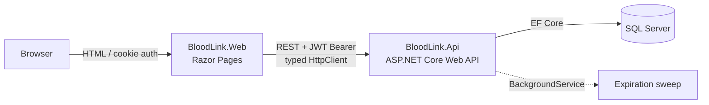

# BloodLink

> Blood bank platform that manages donors, donations and hospital blood requests, enforcing ABO/Rh compatibility, component shelf life and race-free FEFO allocation of scarce units.

[](https://github.com/edu-tech220/bloodlink/actions/workflows/ci.yml)


## 📌 Overview

A blood bank has to answer questions driven by real business rules, not just CRUD:

- Which blood units are compatible with a patient of a given blood type?
- When does a unit expire, given its component (whole blood, red cells, plasma, platelets, cryoprecipitate)?
- Can a donor give blood today, or must they wait because of their age or a recent donation?
- If two hospitals request the same scarce blood type at the same moment, how do we avoid reserving the same unit twice?
- When several units are available, which ones go out first? (The one that expires soonest — **FEFO**, *first-expired, first-out*.)

BloodLink models these rules in the backend and exposes them both to an admin dashboard (blood bank staff) and to hospitals that request units.

## ✨ Key features & business rules

- **ABO/Rh compatibility** for red cells and plasma, derived from antigen properties (O− is the universal red-cell donor, AB+ the universal recipient).
- **Shelf life per component**: whole blood 35 days, red cells 42 days, platelets 5 days, plasma and cryoprecipitate 365 days.
- **Donor eligibility**: donors must be at least 18 years old and wait at least 56 days between donations.
- **Donation workflow**: completing a donation appointment creates a whole-blood unit in `Quarantined` status, which staff then release to `Available` or discard.
- **Blood unit state machine**: `Quarantined → Available → Reserved → Issued`, or `Discarded` / `Expired`.
- **Hospital request state machine**: `Pending → PartiallyReserved → Reserved → Issued`, or `Cancelled` / `Rejected`. Cancelling a request returns its reserved units to `Available`; only `Reserved` requests can be issued.
- **FEFO allocation** on request creation (and on demand), with partial reservations when stock is short.
- **Low-stock summary**: inventory summary per blood type and component, flagging combinations with fewer than 5 available units.
- **Role-based access**: `Admin` (blood bank staff) and `Hospital` users; hospital users only see and manage their own hospital's requests.
- **Automatic expiry**: a background service marks expired units every 30 minutes.

## 🏗️ Architecture

Two independent ASP.NET Core applications that communicate only over HTTP, plus a test project:



- **BloodLink.Api** — ASP.NET Core Web API + EF Core + SQL Server. Exposes JWT-protected REST endpoints (`Admin` and `Hospital` roles) and owns all business logic: blood compatibility, shelf life, donor eligibility and FEFO allocation with optimistic concurrency. It is the only application that touches the database.
- **BloodLink.Web** — ASP.NET Core Razor Pages (server-rendered HTML/CSS, no SPA). It has no database access and no EF Core dependency: everything it shows comes from BloodLink.Api through a typed `HttpClient` registered with `IHttpClientFactory`. The user session is an ASP.NET Core authentication cookie that stores the JWT issued by the API as a claim; a `DelegatingHandler` forwards it as `Authorization: Bearer` on every call.
- **BloodLink.Api.Tests** — xUnit tests that run with `dotnet test` without SQL Server, using in-memory SQLite through `WebApplicationFactory<Program>`.

Each service has its own Dockerfile and can be deployed and scaled separately. The frontend shares no code or EF Core models with the backend: its DTOs are intentionally duplicated so that an internal change in one service never forces a joint deployment of the other.

## 🧠 Technical decisions

- **ABO/Rh compatibility is computed, not hard-coded.** `BloodCompatibilityService` models each blood type as `(HasAntigenA, HasAntigenB, RhPositive)` and derives compatibility from those properties. For red cells, the donor's antigens must be a subset of the recipient's; for plasma the rule is inverted, because what is transfused are antibodies. This is easier to audit than a 64-row lookup table and makes it explicit *why* O− is the universal donor and AB+ the universal recipient.
- **Optimistic concurrency without SQL Server `rowversion`.** Tests run on SQLite while production runs on SQL Server, so instead of a provider-specific `rowversion` column, `BloodUnit` has an `int Version` configured with `IsConcurrencyToken()` and incremented on every state change. EF Core adds the original value to the `WHERE` clause of each `UPDATE` on any provider, so the same code and the same conflict tests work on both databases.
- **FEFO allocation with retry on conflicts.** `BloodAllocationService` selects the compatible units that expire first, reserves them and saves. If another request won the race for the same unit, `SaveChangesAsync` throws `DbUpdateConcurrencyException`; the service clears the change tracker and retries against the refreshed inventory (up to 5 attempts) instead of failing the hospital's request.
- **EF Core migrations vs. SQLite tests.** Migrations are generated with the SQL Server provider and contain engine-specific column types (`nvarchar(max)`, `datetime2`) that fail on SQLite. The test environment therefore uses `Database.EnsureCreated()` (schema built directly from the model with SQLite types), while the real API startup uses `Database.Migrate()` against SQL Server.
- **PBKDF2 + JWT + rate limiting + CORS.** Passwords are hashed with PBKDF2-SHA256 (100,000 iterations, random per-user salt). Login issues a JWT containing the user's role and, when applicable, their `hospitalId`. The login endpoint is protected by a fixed-window rate limiter (5 attempts per 60 seconds by default) to slow down brute-force attacks, and CORS only allows the configured frontend origin.
- **`BackgroundService` for inventory expiry.** `ExpirationSweepService` periodically finds `Available`/`Quarantined` units past their expiry date and marks them `Expired`, so neither the inventory dashboard nor FEFO allocation ever offers an expired unit. A manual endpoint (`POST /api/inventory/sweep-expired`) forces a sweep without waiting for the interval.
- **Real pagination.** Donors, appointments, inventory units and requests are returned paginated (`page` / `pageSize`) instead of dumping whole tables.

## 🗂️ Domain model

| Entity | Role |
|---|---|
| `Donor` | Person who donates; stores blood type and last donation date to compute eligibility. |
| `DonationAppointment` | Donation appointment; when completed it produces a quarantined `BloodUnit`. |
| `BloodUnit` | Physical unit of a blood component, with expiry date and a state machine (`Quarantined → Available → Reserved → Issued`, or `Discarded` / `Expired`). |
| `Hospital` | Organization that requests units. |
| `BloodRequest` | A hospital's order; moves through `Pending → PartiallyReserved → Reserved → Issued` (or `Cancelled` / `Rejected`). |
| `RequestAllocation` | Link between a request and the specific units reserved for it. |
| `User` | Account with role `Admin` (blood bank staff) or `Hospital` (linked to a hospital). |

## 🧰 Tech stack

| Layer | Technology |
|---|---|
| Backend | .NET 8, ASP.NET Core Web API, Swashbuckle (Swagger) |
| Frontend | ASP.NET Core Razor Pages, cookie authentication, typed `HttpClient` |
| Data | Entity Framework Core 8, SQL Server 2022 |
| Security | JWT Bearer, PBKDF2-SHA256 password hashing, ASP.NET Core rate limiting, CORS |
| Background work | `BackgroundService` (hosted service) |
| Testing | xUnit, `WebApplicationFactory`, SQLite in-memory |
| DevOps | Docker, Docker Compose, GitHub Actions |

## 🚀 Getting started

### With Docker Compose (recommended)

Starts SQL Server, the API and the web frontend:

```bash
docker compose up --build
```

| Service | URL |
|---|---|
| Web frontend | http://localhost:5000 |
| API | http://localhost:5080 |
| SQL Server | `localhost,1433` |

On startup the API applies the EF Core migrations against SQL Server and seeds demo data:

| Username | Password | Role |
|---|---|---|
| `admin` | `Admin123!` | Blood bank administrator |
| `hospital` | `Hospital123!` | Staff of the seeded hospital |

> The containers run with `ASPNETCORE_ENVIRONMENT=Production`, so Swagger UI is only enabled when running the API locally in Development (see below).

### Locally without Docker

Requires the .NET 8 SDK and a reachable SQL Server (for example, only the database from `docker-compose.yml`: `docker compose up sqlserver`).

```bash
dotnet run --project src/BloodLink.Api   # http://localhost:5030  (Swagger: /swagger)
dotnet run --project src/BloodLink.Web   # http://localhost:5247
```

Adjust `ConnectionStrings:Default` in `src/BloodLink.Api/appsettings.json` if your SQL Server does not use the default connection string. The web app reads the API address from `Api:BaseUrl` in `src/BloodLink.Web/appsettings.json`.

## 🧪 Running tests

```bash
dotnet test
```

The suite contains **49 test cases** (30 `[Fact]` + 19 `[Theory]` data rows). Tests need neither SQL Server nor Docker: they use in-memory SQLite through `WebApplicationFactory<Program>` (or independent SQLite connections for the concurrency test). They cover:

- ABO/Rh compatibility rules for red cells and plasma.
- Shelf-life calculation per component.
- Donor eligibility (minimum age, interval between donations).
- Password hashing (PBKDF2).
- Authentication and role-based authorization (login, 401, 403 between `Admin` and `Hospital`).
- FEFO allocation, partial allocation and retry, incompatibility leaving a request `Pending`, issuing and cancelling requests.
- Two real requests competing for the same scarce unit: exactly one wins regardless of execution order (optimistic concurrency test with two independent SQLite connections over a shared in-memory database).
- Full flow from donation appointment → quarantined unit → release/discard.

GitHub Actions (`.github/workflows/ci.yml`) restores, builds and runs `dotnet test` for the whole solution on every push and pull request to `main`.

## 🔌 API endpoints

All endpoints except login require a JWT (`Authorization: Bearer <token>`).

| Method | Route | Access | Description |
|---|---|---|---|
| POST | `/api/auth/login` | Anonymous (rate limited) | Authenticate and receive a JWT |
| POST | `/api/auth/register` | Admin | Create a user account |
| GET | `/api/donors` | Admin | List donors (paginated) |
| GET | `/api/donors/{id}` | Admin | Get a donor |
| POST | `/api/donors` | Admin | Register a donor |
| GET | `/api/donors/{id}/eligibility` | Admin | Check whether a donor can donate |
| GET | `/api/appointments` | Admin | List donation appointments (paginated) |
| POST | `/api/appointments` | Admin | Schedule a donation appointment |
| POST | `/api/appointments/{id}/complete` | Admin | Complete a donation and create a quarantined unit |
| POST | `/api/appointments/{id}/cancel` | Admin | Cancel an appointment |
| GET | `/api/hospitals` | Authenticated | List hospitals |
| POST | `/api/hospitals` | Admin | Create a hospital |
| GET | `/api/inventory/summary` | Authenticated | Available units per blood type and component, with low-stock flag |
| GET | `/api/inventory/units` | Admin | List blood units (paginated, filter by status/blood type) |
| POST | `/api/inventory/units/{id}/release` | Admin | Release a quarantined unit |
| POST | `/api/inventory/units/{id}/discard` | Admin | Discard a unit |
| POST | `/api/inventory/sweep-expired` | Admin | Force the expiry sweep |
| GET | `/api/requests` | Authenticated | List requests (hospitals only see their own) |
| GET | `/api/requests/{id}` | Authenticated | Get a request |
| POST | `/api/requests` | Authenticated | Create a request and attempt FEFO allocation |
| POST | `/api/requests/{id}/allocate` | Admin | Retry allocation for a request |
| POST | `/api/requests/{id}/issue` | Admin | Issue a fully reserved request |
| POST | `/api/requests/{id}/cancel` | Authenticated (own hospital or Admin) | Cancel a request and release its units |

## 📁 Project structure

```
BloodLink.sln
├── .github/workflows/ci.yml        # Build + test pipeline
├── docker-compose.yml              # SQL Server + API + Web
├── src/
│   ├── BloodLink.Api/              # Web API — all business logic
│   │   ├── Controllers/            # Auth, Donors, Appointments, Hospitals, Inventory, Requests
│   │   ├── Data/                   # DbContext, seeder, EF Core migrations
│   │   ├── Domain/                 # Entities and enums
│   │   ├── Dtos/                   # Request/response contracts
│   │   ├── Services/               # Compatibility, eligibility, allocation, shelf life, JWT, hashing, expiry sweep
│   │   └── Dockerfile
│   └── BloodLink.Web/              # Razor Pages frontend (no database access)
│       ├── Pages/                  # Dashboard, Donors, Appointments, Hospitals, Requests, Login
│       ├── Services/               # Typed API client, auth header handler
│       ├── Models/                 # Duplicated DTOs
│       └── Dockerfile
└── tests/
    └── BloodLink.Api.Tests/        # xUnit tests (SQLite in-memory)
```
